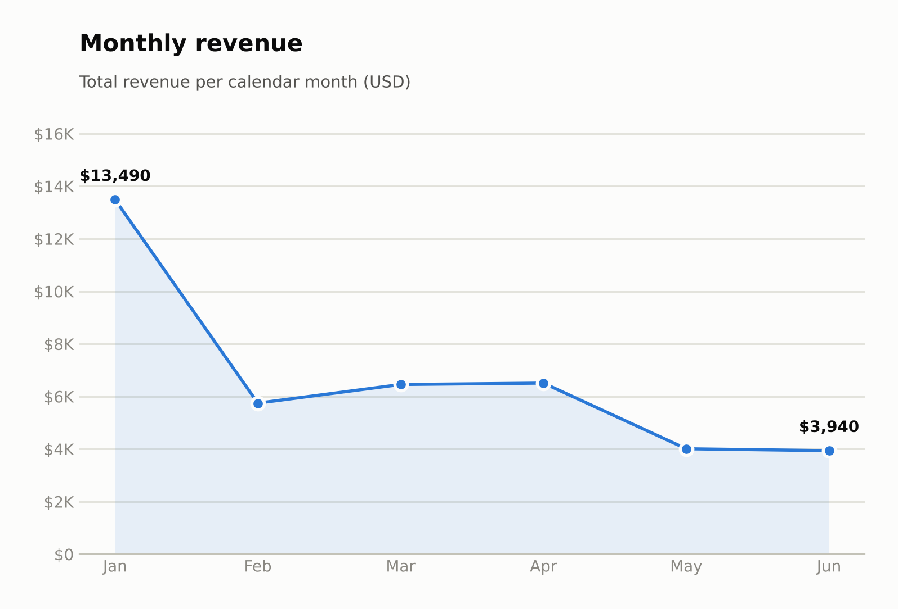
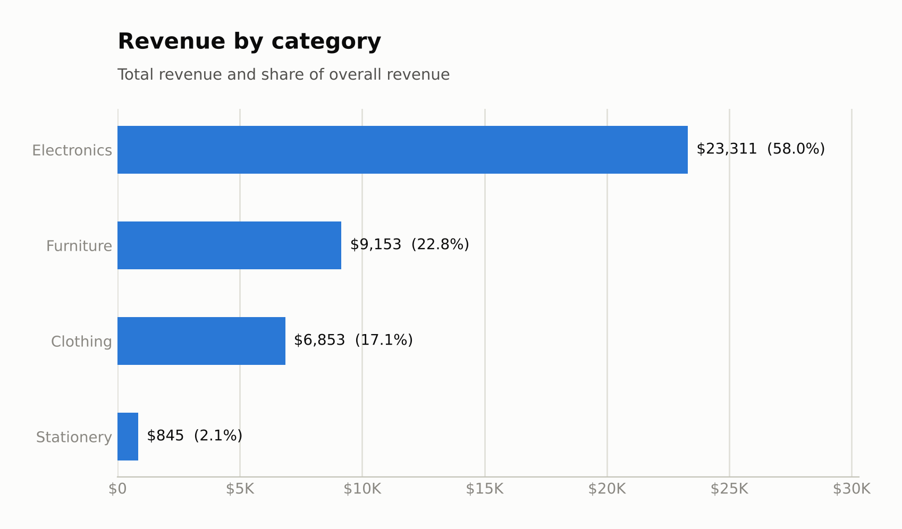
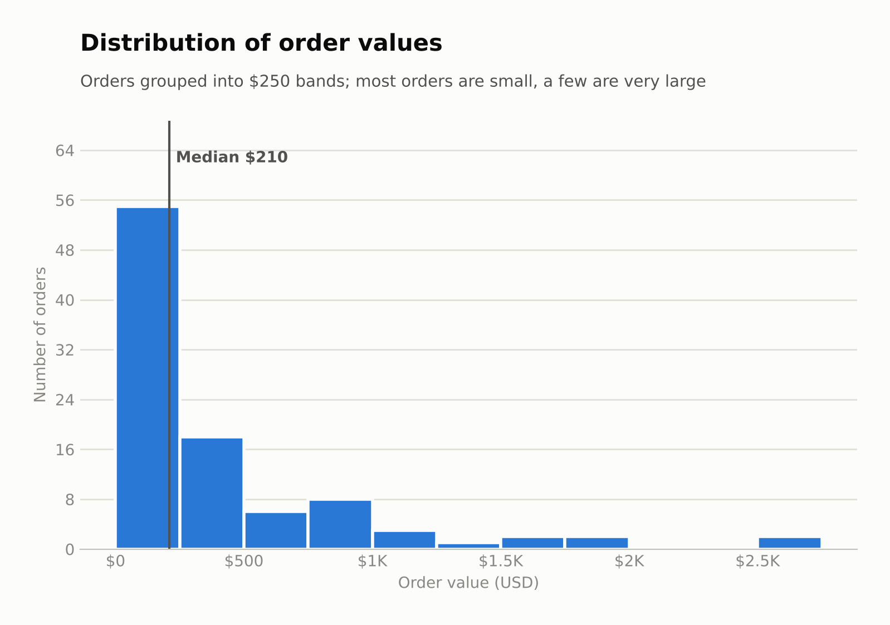
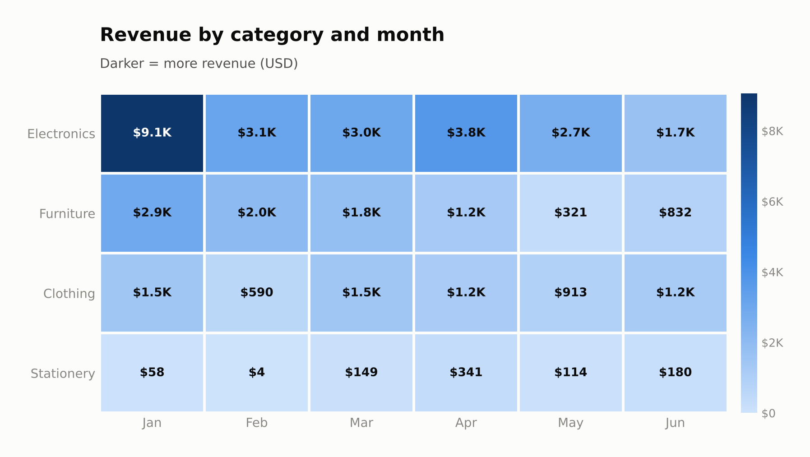

# E-commerce Sales Analysis

A complete data-analysis pipeline in Python: **load -> validate -> clean -> analyze -> visualize -> report**.
It reads a 100-row sales CSV, cleans it, calculates sales metrics, draws four charts
(line, bar, histogram, heatmap) and writes a Markdown report with written insights.

## 1. Project overview

**Goals**

1. Build a repeatable pipeline with error handling and input validation.
2. Find out where revenue comes from (categories, products, months, order sizes).
3. Present the results in at least two chart types and explain them in plain language.

**Dataset:** `data/sales_data.csv` - 100 rows, 5 columns:
`date`, `product`, `category`, `quantity`, `unit_price`.

> **Note on the data:** the provided `sales_data.csv` was not attached to this project, so
> a practice file with the same shape (100 rows x 5 columns) was generated: 11 products, 4 categories,
> Jan-Jun 2026. It deliberately contains **1 duplicate row and 2 rows with missing values** to exercise the
> cleaning step. To analyse your own file, replace `data/sales_data.csv` (same column names) and re-run.
> The findings below describe this sample file, not a real business.

## 2. Setup instructions

```bash
# 1. (optional) create a virtual environment
python -m venv .venv
source .venv/bin/activate          # Windows: .venv\Scripts\activate

# 2. install dependencies
pip install -r requirements.txt

# 3. run the full pipeline
python main.py

# 4. run the tests
python -m pytest -v
```

Optional arguments: `python main.py --input path/to/file.csv --output-dir some/folder`

Outputs: `visualizations/*.png`, `report/report.md`, `report/pipeline.log`, `data/sales_data_clean.csv`.

## 3. Code structure

```
ecommerce-sales-analysis/
|-- main.py                  # entry point: runs the pipeline, handles errors, sets exit codes
|-- requirements.txt
|-- pytest.ini
|-- README.md
|-- data/
|   |-- sales_data.csv       # raw input (100 rows)
|   `-- sales_data_clean.csv # cleaned output
|-- src/
|   |-- config.py            # paths, schema, thresholds, chart colours
|   |-- data_loader.py       # load_data, validate_schema, clean_data
|   |-- analyzer.py          # metrics, group-bys, monthly trend, pivot, correlation
|   |-- visualizer.py        # the four matplotlib charts
|   `-- report.py            # data-driven insights + Markdown report writer
|-- tests/
|   `-- test_pipeline.py     # 17 pytest tests
|-- visualizations/          # generated PNG charts
`-- report/
    |-- report.md            # final report with insights
    `-- pipeline.log         # log from the last run
```

## 4. Technical details

**Pipeline stages**

| Stage | What happens |
|---|---|
| Load | `pd.read_csv`; raises `FileNotFoundError` (missing file) or `DataValidationError` (empty file, bad CSV, missing columns) |
| Clean | normalise column names and text; drop exact duplicates; coerce types (`errors="coerce"`); drop missing/invalid rows; drop non-positive quantity or price; derive `revenue = quantity x unit_price`, `month`, `weekday` |
| Analyze | KPIs, revenue by category and product (with shares), monthly revenue with month-over-month growth, category x month pivot, order-value distribution, Spearman correlation of unit price vs quantity |
| Visualize | four charts saved at 200 dpi |
| Report | insights are generated from the computed numbers, so the text always matches the data |

**Data structures and algorithms:** pandas `DataFrame` for the data; `groupby`/`pivot_table` aggregations;
`dict` for metrics; Spearman rank correlation (pandas); median/mean/skew for the order-value distribution.

**Cleaning assumption:** the file has no order id, so rows that are identical in all five columns are treated as
accidental duplicates.

**Error handling:** `main.py` returns exit code `0` on success, `1` for a missing input file, `2` for invalid data,
`99` for an unexpected error. Every run writes a log to `report/pipeline.log`.

## 5. Charts (screenshots)

| Chart type | Shows | File |
|---|---|---|
| Line | monthly revenue | `visualizations/monthly_revenue_line.png` |
| Horizontal bar | revenue by category | `visualizations/category_revenue_bar.png` |
| Histogram | distribution of order values | `visualizations/order_value_histogram.png` |
| Heatmap | revenue by category and month | `visualizations/category_month_heatmap.png` |






## 6. Key findings

Full write-up with tables: [`report/report.md`](report/report.md).

- **Revenue is concentrated.** Electronics makes 58.0% of the $40,161 revenue from 21.6% of orders; Stationery
  is 21.6% of orders but only 2.1% of revenue.
- **Three products (Smartphone, Laptop, Standing Desk) generate 61.8% of revenue.**
- **Typical orders are small, a few are huge.** Median order $210 vs average $414; the 24 orders of $500 or more
  are 24.7% of orders but 68.2% of revenue.
- **Cheaper items are bought in larger quantities** (Spearman rho = -0.51).
- **Monthly revenue fell from $13,490 (Jan) to $3,940 (Jun)**, but January is mostly one large Electronics month
  (about 3.2x Electronics' average in the other months), so the decline should be read cautiously.

## 7. Testing evidence

17 tests in `tests/test_pipeline.py` - run with `python -m pytest -v`:

```
test_load_missing_file_raises PASSED
test_load_empty_file_raises PASSED
test_load_missing_columns_raises PASSED
test_load_real_dataset_shape PASSED
test_clean_removes_duplicates PASSED
test_clean_removes_missing_and_invalid PASSED
test_clean_removes_non_positive PASSED
test_clean_all_rows_invalid_raises PASSED
test_revenue_is_quantity_times_price PASSED
test_totals_are_consistent PASSED
test_shares_sum_to_100 PASSED
test_known_values PASSED
test_describe_correlation PASSED
test_charts_are_created PASSED
test_full_pipeline_on_real_data PASSED
test_pipeline_exit_code_missing_file PASSED
test_pipeline_exit_code_bad_schema PASSED
============================== 17 passed in 2.26s ==============================
```

**Validation examples**

| Input | Result |
|---|---|
| file does not exist | exit code 1, "Input file not found" |
| empty file | `DataValidationError`, exit code 2 |
| CSV without the required columns | `DataValidationError: Missing required column(s)`, exit code 2 |
| all rows invalid after cleaning | `DataValidationError: No valid rows remain` |
| real dataset | 100 rows loaded, 3 removed (1 duplicate, 2 missing), 97 analysed |

**Consistency checks (automated):** total revenue equals the sum over categories, products, months and the
category x month pivot; category shares sum to 100%.

## 8. Limitations

- Small sample (97 orders, 6 months): percentages move noticeably with a few extra orders.
- No customer or order id, so repeat-buyer analysis is not possible.
- Charts use a single colour for single-series data and a light-to-dark blue scale for the heatmap.
